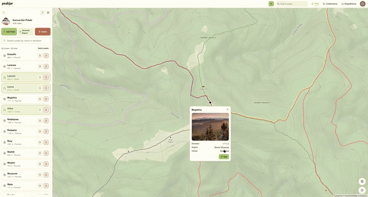
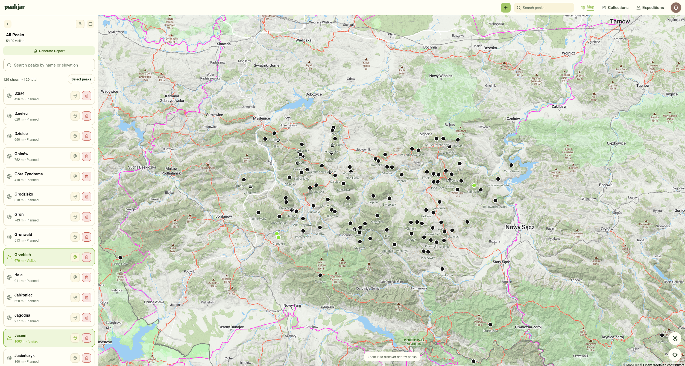
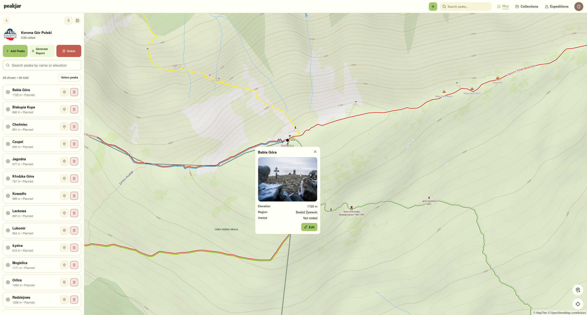
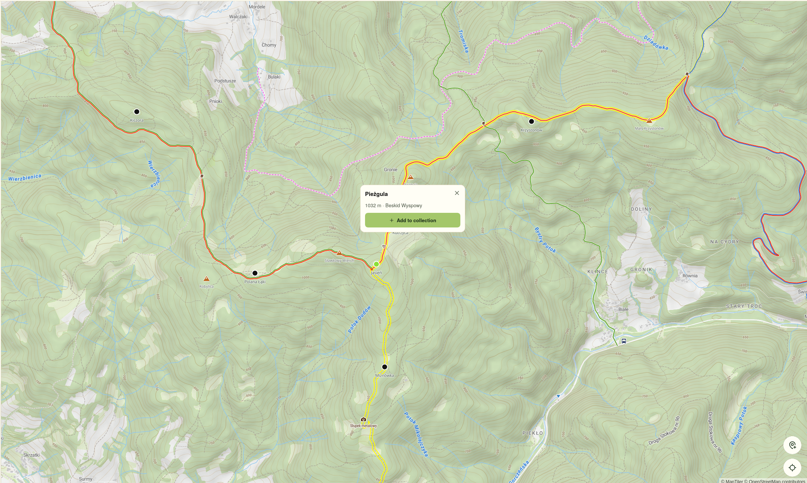
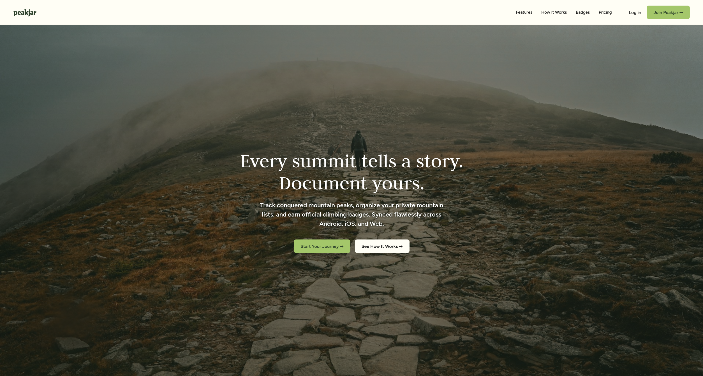
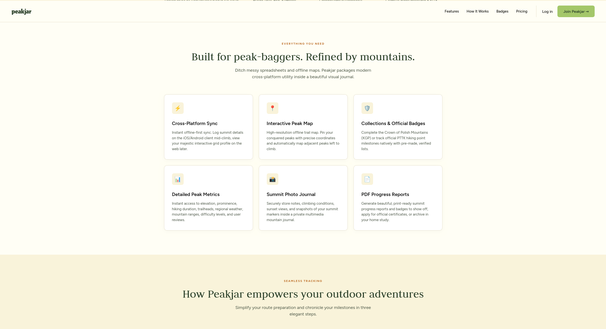

# Peakjar

A cross-platform app for hikers who collect mountain peaks: mark summits on a map, record trips with GPX, organize peaks into collections, track badge progress and keep a digital journal of your mountain activity. Runs on Android, iOS and web.

> **Status:** v0.2 in development. Version 0.3 with a waitlist is planned by the end of 2026, v1.0 in early 2027. The source code lives in a private repository.

> Demo (35 s): see the video below.

https://github.com/user-attachments/assets/cc8680bc-d048-47b8-926c-88f202f1735a

## Features

- **Interactive map** for adding, viewing and editing peak markers, including custom peaks anywhere on the map
- **Trips with GPX**: a trip stores the whole route (GPX track) and the summits reached; importing a GPX file suggests peaks to add to your collection
- **Collections** that group summits into thematic sets
- **Badge tracking** with progress views and profile summaries, built with tourist badge programs such as PTTK in mind
- **Detailed peak data**: elevation, notes, ratings, tags, photos and multiple visit dates
- **Offline mode**: fully available on mobile; on web, peaks added offline are queued in browser storage and synced when you are back online
- **PDF reports** of collection progress, ready to share
- **Per-user sync** across devices through an authenticated API

## Tech stack

**Client:** Expo, React Native, TypeScript, Expo Router, MapLibre (native) with a Leaflet web fallback, TanStack Query, Zustand, Clerk

**Back end:** Java 17, Spring Boot, PostgreSQL with PostGIS, Spring Security (OAuth2 Resource Server), Flyway, OpenAPI

**Delivery:** Expo (Android, iOS, static web), Docker Compose

## My role

I build the client application (all platforms) and co-designed the REST API contracts with the back-end developer, who builds the Java API.

## Contact

Patryk Zdebik · [LinkedIn](https://www.linkedin.com/in/patryk-zdebik/)

© 2026 Patryk Zdebik. All rights reserved. The source code is in a private repository.
